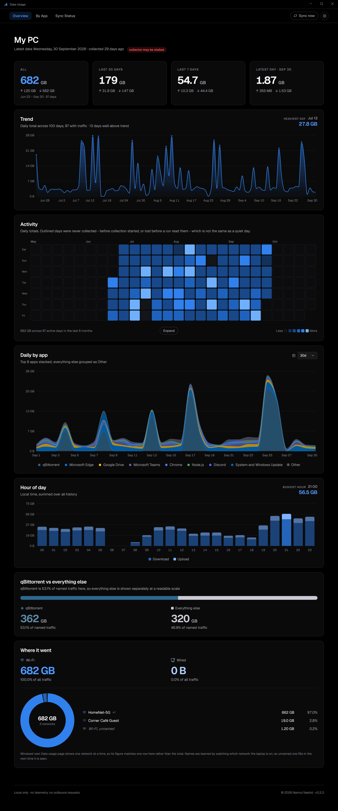
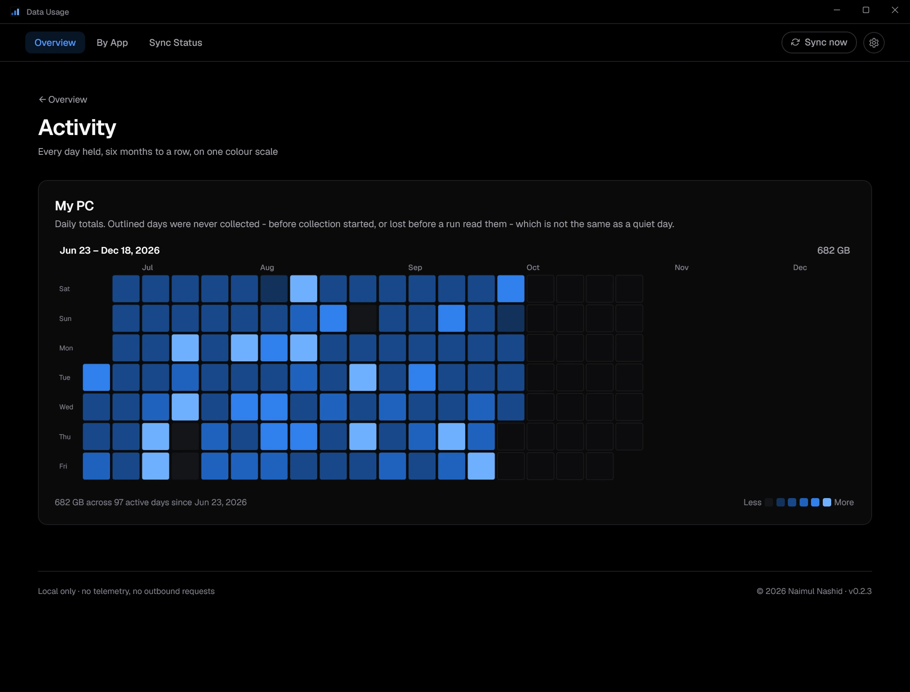
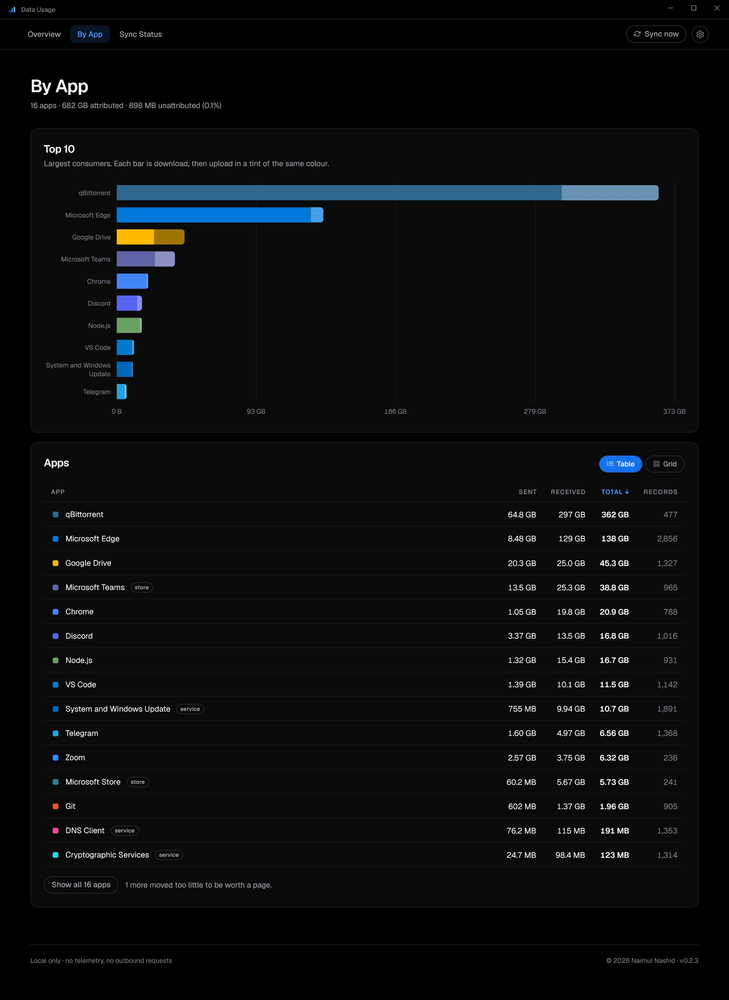
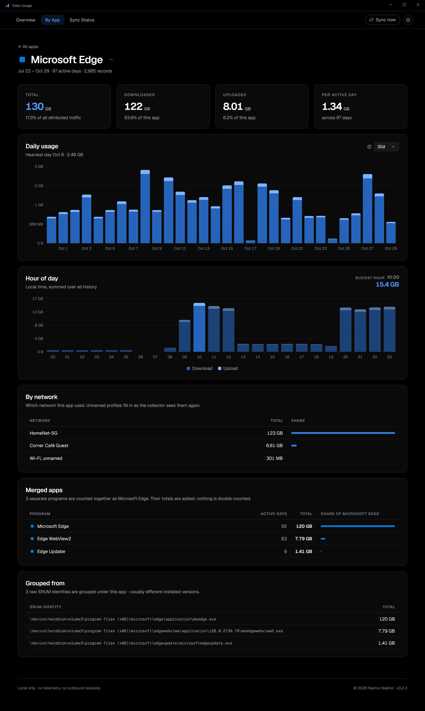
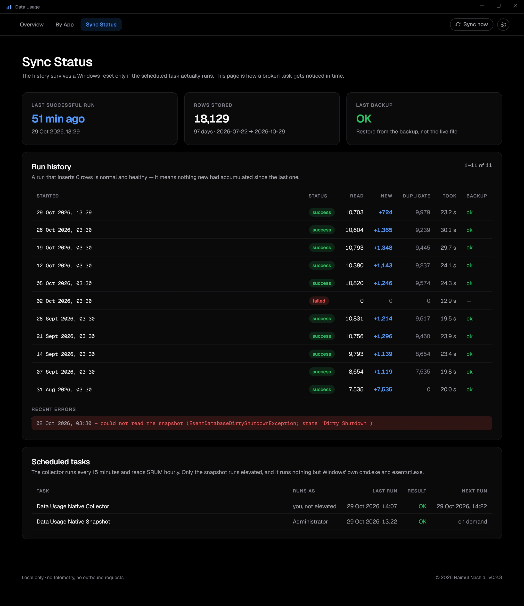
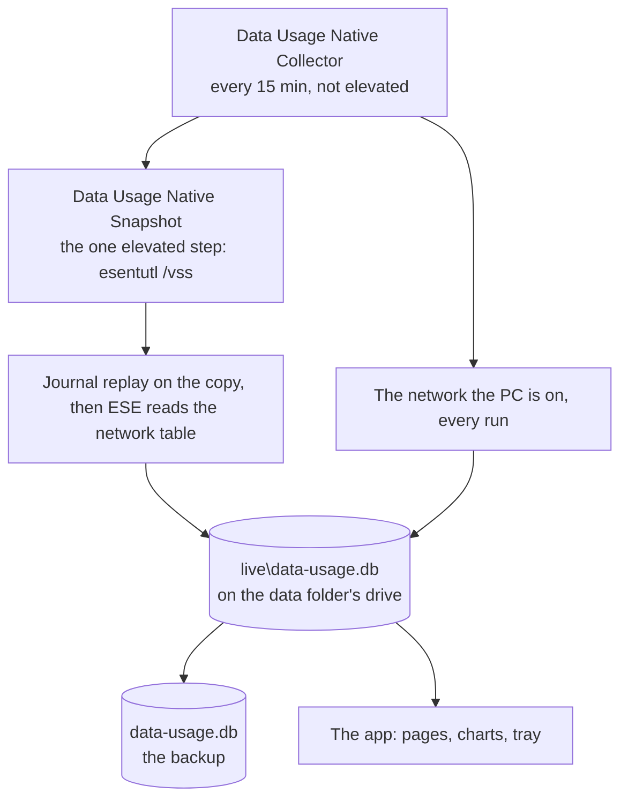

#  Data Usage (native)

[](https://github.com/naimulnashid/data-usage-native/actions/workflows/ci.yml)
[](https://github.com/naimulnashid/data-usage-native/releases/latest)
[](LICENSE)

A native Windows app that keeps a **permanent history of how much data each
app on this PC uses**. Windows already measures it (Settings → Network &
Internet → Data usage) but keeps only a month or two, and a Windows reset
erases even that. This app copies it out every hour into a database on
another drive, so the history survives.

Built with WinUI 3 on .NET 10. A native port of the
[Data Usage Dashboard](https://github.com/naimulnashid/data-usage-tracker) web
app, sharing its design and its rules but no code. Local only: no network
calls, no server, no account.

## Screenshots

Every page, top to bottom, in the dark theme and the light one. **Every number
is invented**: the history comes from `datausage demo-data`, and the pictures
from `tools\Capture-Views.ps1` (see [Development](#development)). Each image
follows your GitHub theme.

<details open>
<summary><b>Overview</b>: totals, trend, activity, daily by app, hour of day, the split, where it went</summary>

<picture>
  <source media="(prefers-color-scheme: light)" srcset="docs/screenshots/overview-light.webp">
  
</picture>

</details>

<details>
<summary><b>Activity</b>: the full history as a heat map, in 26-week blocks</summary>

<picture>
  <source media="(prefers-color-scheme: light)" srcset="docs/screenshots/activity-light.webp">
  
</picture>

</details>

<details>
<summary><b>By App</b>: the top 10 as download/upload bars, and every app in a table or a grid</summary>

<picture>
  <source media="(prefers-color-scheme: light)" srcset="docs/screenshots/by-app-light.webp">
  
</picture>

</details>

<details>
<summary><b>App detail</b>: daily usage, hour of day, by network, merged programs, raw identities</summary>

<picture>
  <source media="(prefers-color-scheme: light)" srcset="docs/screenshots/app-detail-light.webp">
  
</picture>

</details>

<details>
<summary><b>Sync Status</b>: last run, run history with errors, and both scheduled tasks</summary>

<picture>
  <source media="(prefers-color-scheme: light)" srcset="docs/screenshots/sync-status-light.webp">
  
</picture>

</details>

## Features

- **Overview**: all-time, 30-day, 7-day and latest-day totals (up and down);
  the daily trend with the heaviest day and days well above trend marked; a
  six-month activity heat map (Expand for the full history); daily traffic by
  app; hour of day; an optional "one app vs everything else" split; and
  **where it went**: Wi-Fi against wired, and each network on a ring.
- **By App**: the top 10 as download/upload bars, and every app as a table or a
  grid of cards. Hide an app you do not want listed, or merge one app into
  another (and separate it again). Apps with enough history open a detail
  page: daily usage, hour of day, by network, the programs merged into it, and
  the raw identities behind it.
- **Sync Status**: whether collection is actually running, the run history, and
  the two scheduled tasks as Windows reports them.
- **Every page covers all history**; Daily by app and an app's Daily usage each
  have a 7d / 30d / 90d / All menu, opening on 30d.
- **Names Windows would show**: versioned install folders, store package
  versions and service names fold into one app each, and the detail page lists
  what was merged.
- **The tray icon** keeps the latest day's traffic in its tooltip, and its menu
  follows the app's light or dark theme. Notifications when a collection fails
  or stalls.
- **Light or dark**, browser-style zoom from 50% to 200%, and Backspace to go
  back from an app's page.

## Installation and getting started

Windows 10 (version 2004 or later) or Windows 11, x64. Windows asks for
administrator approval once, to register the scheduled tasks.

**From a release** (nothing else to install): download
`DataUsage-<version>-win-x64.zip` from
[Releases](https://github.com/naimulnashid/data-usage-native/releases), extract
it, and in that folder run:

```powershell
powershell -ExecutionPolicy Bypass -File .\Install.ps1
```

**From source**: needs the [.NET 10 SDK](https://dotnet.microsoft.com/download)
(`global.json` pins 10.0.100 or a later feature band). From the root of a clone:

```powershell
powershell -ExecutionPolicy Bypass -File tools\Install.ps1
```

Either way it installs a self-contained build to `%LOCALAPPDATA%\Programs\Data Usage`,
adds **Data Usage** to the Start menu and to **Settings → Apps → Installed
apps** (and Control Panel's Programs and Features), sets the data folder
(`-DataDir`, default `D:\PersistentData\data-usage-native`; with no `D:` drive
the app asks on first run), and registers two scheduled tasks. It prints each
step as it goes, and does not open the app when it finishes: start **Data
Usage** from the Start menu.

**Keep the data folder off the Windows drive**, ideally in a folder a cloud
client backs up: that is what makes the history survive a reset.

**Uninstall** from Installed apps, or `Install.ps1 -Uninstall`. Your
history is never deleted.

**After a Windows reset**, reinstall with `-DataDir` pointing at the same
folder. Everything collected before the reset is still there.

## Configuration

No configuration file is needed; everything below has a default.

**The data folder** (`-DataDir` at install, or the folder chosen on first run)
holds everything that must survive a reset:

| Path | What it is |
|---|---|
| `live\data-usage.db` | The working SQLite database. |
| `data-usage.db` | A consistent backup, rewritten after each collection. **Restore from this one.** |
| `logos\` | App logos, named after the app (`Bitwarden.svg`). |
| `settings.json` | `DeviceLabel` (the name on the overview) and `SplitApp` (the app shown against everything else), both set from **This PC…** in the settings menu. |

**The local folder**, `%LOCALAPPDATA%\Data Usage Native`, holds what is cheap
to lose:

| Path | What it is |
|---|---|
| `location.json` | Which data folder to use. `Install.ps1` writes it. |
| `app-settings.json` | Theme, zoom, By App's table or grid, tray and notification choices. |
| `logs\` | The collector's logs. |

Two environment variables move both folders, for demo or test runs:
`DATAUSAGE_DATA_DIR` (the data folder) and `DATAUSAGE_LOCAL_DIR` (the local
folder). Set both, or a demo run writes into your real preferences.

## Usage

- **Sync now** (top bar or tray) collects immediately; otherwise the collector
  runs every 15 minutes and reads Windows' database hourly.
- **Choose a range** for a daily chart from the menu at its top right.
- **Rename an app, or change its colour**: the "..." beside its name (hover a
  table row or card, or on the app's own page), then **Rename or recolour…**.
  Pick a colour or type its hex code; "Default colour" goes back. Both are
  stored with the history.
- **Hide or merge an app**: the same "..." on By App. A hidden app leaves By
  App and nothing else, so every total still counts it; **Show N hidden** lists
  them again. A merged app is counted as part of the other everywhere, and that
  app's **Merged apps** card has a Separate button to undo it.
- **Table or grid** on By App: the switch at the top right of the Apps card.
- **Click a Top 10 bar or a card** to open that app's page; **Backspace** goes
  back.
- **Logos**: in the "..." menu choose **Set logo…** (or **Remove logo**), or
  drop an image on the app's name or card. Files dropped into the data folder's `logos\` work too.
- **Zoom** like a browser: **Ctrl+Plus**, **Ctrl+Minus**, **Ctrl+mouse wheel**,
  **Ctrl+0** to reset (remembered). Also in the settings menu.
- **Tray**: closing the window keeps the app in the notification area.
  Right-click it for Sync now, the options and Exit.
- **Start at login**: settings menu or tray. It starts straight to the tray.
- **Light or dark**: Settings > Theme, or follow Windows' setting.

The app always opens maximised.

**Why the total can differ from Windows'**: Windows' Data usage page shows
**one network at a time**. The totals here cover every network, so they are
higher whenever the PC has used more than one. The per-network rows under
"Where it went" are the figures to compare.

## Tech stack and architecture

- **App**: WinUI 3 (Windows App SDK) on .NET 10, built in code rather than
  XAML; charts are drawn on XAML shapes. H.NotifyIcon for the tray, Svg.Skia
  for SVG logos, Geist for type.
- **Core**: SRUM read through Windows' own ESE engine (`esent.dll`, via
  ManagedEsent), so no third-party parser; SQLite (Microsoft.Data.Sqlite) for
  the history.
- **CLI**: `datausage`, for collection, a report, the demo history and checks.



- **Data Usage Native Collector** runs every 15 minutes, unelevated and without
  a window. It records which network the PC is on, and once an hour reads
  Windows' usage database (SRUM) into the history, then writes a consistent
  backup beside it.
- **Data Usage Native Snapshot** is the one step that needs Administrator: a
  shadow copy of the locked SRUM file. It runs only Windows' own `cmd.exe` and
  `esentutl.exe`, with arguments fixed when you approved the install. The
  collector starts it on demand; no prompt appears.

## Security and privacy

- **Where data lives**: the history, its backup, the logos and the device
  settings are in the data folder you chose; preferences and logs in
  `%LOCALAPPDATA%\Data Usage Native`. None of it is encrypted, so anyone who
  can read the data folder can read which apps used the network and when.
- **Nothing leaves the PC**: the app makes no network calls, has no account and
  sends no telemetry. A cloud client you point at the data folder is the only
  copy that leaves, and that is your choice.
- **No credentials**: there is nothing to sign in to and no keys or tokens.
- **Privileges**: only the snapshot task runs as Administrator, and it runs
  nothing but Windows' own `cmd.exe` and `esentutl.exe` with fixed arguments;
  the app, the collector and anything you can edit run as you. The snapshot
  folder is created with an ACL that only SYSTEM and Administrators can write.
- **Known limitations**: the database is unencrypted, and Windows' task
  scheduler and SRUM are internals that a future Windows may change.

To report a vulnerability, see [SECURITY.md](SECURITY.md).

## Development

From the root of a clone, in PowerShell 7 (`pwsh`):

```powershell
dotnet build DataUsageNative.slnx
dotnet test --project tests\DataUsage.Core.Tests\DataUsage.Core.Tests.csproj
dotnet run --project src\DataUsage.Cli -- stats           # totals and top apps
dotnet run --project src\DataUsage.Cli -- demo-data demo-data   # an invented history
```

**The screenshots** are captured from that demo history with the Debug build:

```powershell
dotnet build src\DataUsage.App\DataUsage.App.csproj -c Debug -p:Platform=x64
& tools\Capture-Views.ps1 -Views 'overview=overview,0' -FullPage 1440
```

`Capture-Views.ps1` writes PNGs to `screenshots\` (git-ignored); the README's
copies are those as WebP (`ffmpeg -i <png> -c:v libwebp -quality 92 <webp>`),
in `docs/screenshots/`, dark and `-light`. The demo's own theme is `Theme` in
`demo-data\local\app-settings.json`.

`dotnet run --project src\DataUsage.Cli -- read-srum <snapshot> --csv <SrumECmd csv>`
checks the SRUM reader field by field against
[SrumECmd](https://ericzimmerman.github.io/)'s output for the same file.

A **release build** is what `tools\Install.ps1` publishes: a self-contained
`dotnet publish` of `src\DataUsage.App` in Release, into `publish\DataUsage`.

## Contributing, license and support

Issues and pull requests are welcome; see [CONTRIBUTING.md](CONTRIBUTING.md).
Please leave your own usage data and network names out of reports.

Released under the [MIT](LICENSE) license. Geist is © Vercel, under the SIL
Open Font License (`src/DataUsage.App/Assets/Fonts/OFL.txt`).

Questions and bug reports go to the
[issue tracker](https://github.com/naimulnashid/data-usage-native/issues).
